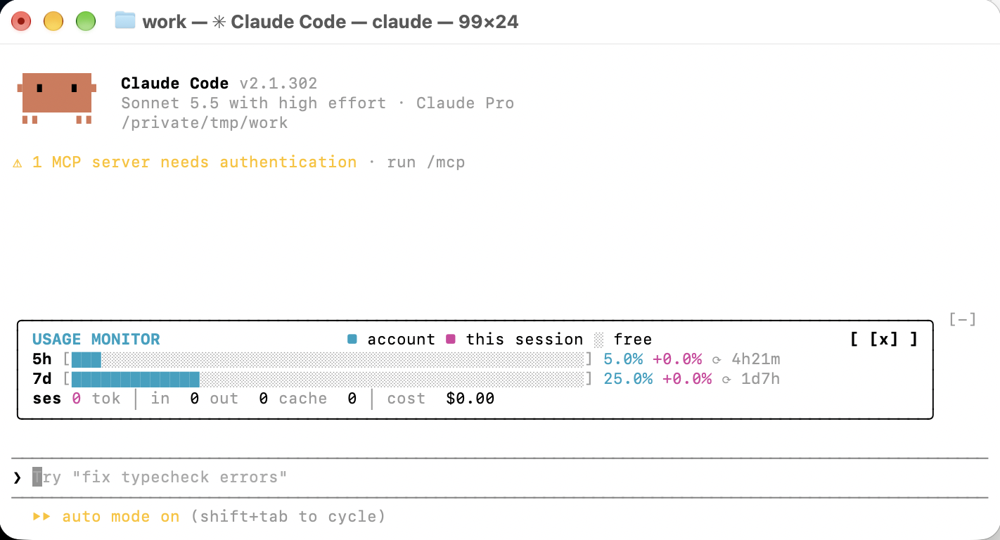

# claude-usage-monitor

**English** | [日本語](README.ja.md)

## Overview
A mod (plugin name: `usage-monitor`) that shows a **USAGE MONITOR** above the prompt input in Claude Code.

### Screenshot
```
╭──────────────────────────────────────────────────────────────╮
│ USAGE MONITOR           ■ account ■ this session ░ free   [x] │
│ 5h [██████░░░░░░░░░░░░░░░░░░] 12.0% +3.1% ⟳ 4h51m             │
│ 7d [█░░░░░░░░░░░░░░░░░░░░░░░]  4.0% +0.4% ⟳ 4d19h             │
│ ses 445.1k tok │ in 16.3k out 3.7k cache 425.0k │ cost $1.85  │
╰──────────────────────────────────────────────────────────────╯
```



### Features
- **5h / 7d**: Usage of your account's rate limits. In each bar, magenta is what this session used, cyan is everything else, and `░` is free. The time on the right is how long until the limit resets.
- **+x.x%**: The increase since the first usage reading this session captured (it goes back to 0 when you restart).
- **ses**: This session's total tokens (input, output, cache), the in / out / cache breakdown, and the cost.
- When rate-limit values can't be read, such as in environments without a subscription, "waiting for the first rate-limit reading…" is shown.

## Installation

In a Claude Code session in the terminal, enter the following. Replace `<owner>` with the GitHub user or organization name that hosts this repository (`claude-usage-monitor`).

```
/plugin install usage-monitor --marketplace <owner>/claude-usage-monitor
```

Answer `y` to `Add marketplace?`, and press Enter at the scope prompt that follows (user scope). To install from a local folder, give the path of the cloned folder instead of `<owner>/claude-usage-monitor`.

You can toggle the band on and off with `/usage-monitor` (or hide it with `[x]`).

### Install from a clone or tarball (`scripts/install.sh`)

From the folder where you cloned the repository (or extracted a tarball), you can choose where to install. After copying, the script also runs `claude plugin marketplace add` and `claude plugin install`.

```sh
bash scripts/install.sh                  # user: copy to ~/.claude/plugins/claude-usage-monitor (user scope)
bash scripts/install.sh --project [DIR]  # repository: copy to DIR (default: current directory)/.claude/plugins/claude-usage-monitor (project scope)
bash scripts/install.sh --target DIR     # any: copy to DIR/claude-usage-monitor (user scope)
```

| Option | Meaning |
|---|---|
| `-y`, `--yes` | Run without asking for confirmation |
| `--no-register` | Only copy; do not register with `claude` |
| `--dry-run` | Change nothing; only show what would be done |

- The plugin is loaded from the install location. Do not move or delete it after installing.
- Only one registration exists for the marketplace name `claude-usage-monitor` (shared by user and project scopes). If it is already registered from another source (such as GitHub), the script warns you before running, and the registration is repointed.
- The `--project` setting is written to `<DIR>/.claude/settings.json` with an absolute path. When sharing with a team, have each person run `install.sh`.
- To update, fetch the new content, run the same command again, and enter `/reload-plugins`.

## Detailed distribution and installation guide (for non-engineers)

[docs/share-and-install-guide.md](docs/share-and-install-guide.md) (in Japanese) covers, for both the person distributing the plugin and the person using it, the steps, how to read the screen, how to turn it off or remove it, and what to do when something goes wrong.

## Development
Commands for checking your work during development.
- Validate the configuration and the shape of the code, verify the logic with tests, and run the plugin for real to see how it behaves on screen
- Check in this order: shape (validate) → logic (test) → actual behavior (--plugin-dir)

```sh
claude plugin validate .
claude plugin test .
claude --plugin-dir .
```

### Automatic check before push (pre-push hook)

Before `git push`, `claude plugin validate .` and `claude plugin test .` run automatically. If either fails, the push is aborted. What is checked is the content of the commits being pushed, not the working tree.

```bash
bash scripts/setup-hooks.sh            # enable in this clone (core.hooksPath = .githooks)
bash scripts/setup-hooks.sh --remove   # disable
git push --no-verify                   # bypass once
```

- The hook setting is needed in each clone (it is written to `.git/config` and is not part of the repository).
- In environments where the `claude` command is not on PATH (such as GUI Git clients), the push is aborted.

## License

[MIT](LICENSE)

---

🤖 Built with [Claude Code](https://claude.com/claude-code)
